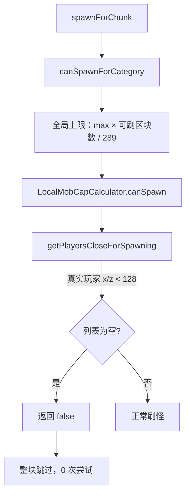

# 相机中心的实体可见性（C 方案）

> 状态：方向稿（未开工）。范围：相机播放期间，服务端「中心」与客户端实体可见性。
> 口径：**玩家不动，相机就是相机**——不移动真实玩家、不注册假 `ServerPlayer`；在原版规则上把「位置源」换成相机。
> 本文只定义机制、缺口与验收，不含实现代码。

---

## 〇、结论

1. **「完全交还原版」不成立**：1.20.1 的刷怪与实体链不是单一中心，至少有 4 处直接读 `ServerPlayer` 实体坐标（刷怪门、局部上限、最近玩家、消失判定）；ticket 只影响「附近有没有玩家 / 可刷怪区块数」，改不了这些查询读到的坐标。
2. 采用 **C 方案**：保留虚拟中心 + 少量原版查询替换；目标不是「零 mixin」，而是「**同一套相机位置源 + 原版判定规则**」。
3. 需要分开看两条链：
   - **刷怪分布**（服务端）：决定相机区有没有新怪、上限怎么算。
   - **实体可见性**（配对 + 客户端渲染）：决定已经存在的怪在相机画面里看不看得见。
   两者共用「相机位置」这一个输入，但断点不同，不能用一个结论覆盖。
4. 当前最可疑的可见性缺口（按置信排序，详见 §2.6）：
   - 实体配对只在**区块变化**时刷新，而位置上报是**每 20 tick**一次 → 相机在同一区块内移动时，静止实体的配对状态不更新；
   - 视图中心整帧只有一份（`topLane`），多 lane 时非顶层 lane 没有自己的中心；
   - 客户端实体可见半径（约 84 格）小于服务端配对半径（128 格）→ 84–128 格这一圈「已下发但永不绘制」。
5. 刷怪侧的确定性缺口：`LocalMobCapCalculator.canSpawn` 在「相机区没有任何真实玩家」时返回 `false`，导致 `spawnCategoryForChunk` 整块跳过（§2.3）。

---

## 一、现有四套「中心」

| # | 机制 | 位置 | 改了什么 | 没改什么 |
|---|---|---|---|---|
| 1 | 区块/发送中心 | `ChunkMapCameraMixin` | `move` / `updatePlayerPos` 里的 `SectionPos.of(player)`、`getBlockX/Z` → 相机 section | 只影响 PLAYER ticket、区块发送/遗忘、`lastSectionPos` |
| 2 | 实体配对中心 | `ChunkMapTrackedEntityCameraMixin` | `ChunkMap$TrackedEntity.updatePlayer` 里的 `player.position()` → 相机 x/z | 配对距离仍是原版 2D 规则 |
| 3 | 刷怪/消失锚点 | `CameraAnchorManager` + `ChunkMapMixin` / `NaturalSpawnerMixin` / `MobDespawnCameraMixin` | `anyPlayerCloseEnoughForSpawning` 在锚点 128 内强制 `true`；最近玩家在真实/虚拟间取更近 | `getPlayersCloseForSpawning`、`LocalMobCapCalculator`、自定义刷怪器 |
| 4 | 写入/释放 | `ChunkPreloadManager` | 客户端每 `preloadReportInterval` tick 上报一次；相机跨区块或 `cameraMode` 翻转时调 `ChunkMap.move` | 没有服务端超时兜底；上报节拍与配对刷新节拍不一致 |

### 1.1 位置源与 y 语义

| 状态 | 写入 | y | 消费方 |
|---|---|---|---|
| `CameraVirtualCenterState.section` | 每次上报 | `0` | `ChunkMap.move` / `updatePlayerPos`（只读 x/z，y 不参与 ticket） |
| `CameraVirtualCenterState.center` | 每次上报 | `0` | `TrackedEntity.updatePlayer`（只读 x/z，2D 配对） |
| `CameraAnchorManager` 的虚拟玩家 | 每次上报 | 锚点区块的**地表高度** | `NaturalSpawnerMixin` / `MobDespawnCameraMixin`（3D 距离） |

**结论**：区块与配对侧 y 无关；刷怪/消失侧 y 用错了（地表 ≠ 相机）。C 方案应统一成相机 y（§4 C3）。

---

## 二、原版链路与接入点

### 2.1 刷怪链

| # | 环节 | 原版判据 | 用谁的位置 | 我们的接入 | 结果 |
|---|---|---|---|---|---|
| 1 | 候选区块 | `chunkMap.getChunks()` 中 `getTickingChunk() != null` | 无 | 相机 ticket 生效 | 相机模拟距离内进入候选 |
| 2 | 可刷怪 | `isNaturalSpawningAllowed(chunk)` = `Visibility.TICKING` | 无 | 同上 | 相机区块可刷 |
| 3 | 外层门 | `anyPlayerCloseEnoughForSpawning` | **真实玩家 x/z**，128 | `ChunkMapMixin` HEAD：锚点 128 内 `true` | 已打开 |
| 4 | 类别门 | `SpawnState.canSpawnForCategory` | 全维度计数 + 可刷区块数 | 无 | 全局上限约 70 MONSTER |
| 5 | **局部上限** | `LocalMobCapCalculator.canSpawn` → `getPlayersCloseForSpawning` | **真实玩家 x/z**，128；**空列表 → `false`** | **无** | **相机远离玩家时整块跳过** |
| 6 | 刷怪点 | `getNearestPlayer(x,y,z,-1,false)` | 真实玩家（可能几千格） | `NaturalSpawnerMixin` 取更近者 | 已兜住最近玩家 |
| 7 | 距离门 | `d² > 576`（24 格）、离出生点 24 格、`d² ≤ despawnDistance²` | 第 6 步选中的玩家 | 同上 | 3D 球；虚拟玩家 y 为地表 |
| 8 | 消失 | `Mob.checkDespawn`：`d² > 128²` discard；`d² < 32²` 清 `noActionTime` | 最近玩家（3D） | `MobDespawnCameraMixin` | 已兜住，但 y 为地表 |
| 9 | 自定义刷怪 | phantom / patrol / cat / siege / trader | `level.players()` / `getRandomPlayer()` | 无 | 相机区不生成 |

### 2.2 「128」的三套语义

| 语义 | 原版实现 | 是否硬编码 | 我们的对应 |
|---|---|---|---|
| 区块「够近可刷」 | `ChunkMap.playerIsCloseEnoughForSpawning`：`d0 < 16384.0D` | **字面量** | `CameraAnchorManager.isAnyAnchorNear` 的 `16384.0` |
| 消失距离 | `MobCategory` 构造参数：多数 128，`WATER_AMBIENT` 64；`Mob.checkDespawn` 读 `getDespawnDistance()` | 分类枚举值 | `getVirtualPlayer` 的 128 过滤（对 64 类是放宽，后续原版再判） |
| 不消失距离 | `MobCategory.getNoDespawnDistance()` → `32` | 硬编码 | 未涉及 |

补充：`NaturalSpawner.SPAWN_DISTANCE_BLOCK = 128` 存在，但 1.20.1 源码中**没有任何引用**（死常量）；真正生效的是 `ChunkMap` 的字面量。因此不能把我们的两处 `16384.0` 合并成一个「刷怪距离」常量——一处是区块门，一处是最近玩家资格上限。

### 2.3 局部上限断点（刷怪分布）

证据：`NaturalSpawner.java:107, 499-505`、`LocalMobCapCalculator.java:23-26, 38-47`、`ChunkMap.java:982-996, 999-1005`、`ChunkMapMixin.java:25-30`。
**这是「相机区不补充新怪」的确定性缺口**，与「看得见看不见」是两条独立问题。

### 2.4 实体配对链（服务端）

| 环节 | 行为 | 证据 |
|---|---|---|
| 范围 | `range = clientTrackingRange × 16`；实际 `min(range, viewDistance × 16)` | `ChunkMap.java:1330-1415` |
| 距离 | **2D**：`dx² + dz²`（y 被显式丢弃） | `ChunkMap.java:1385-1400` |
| 配对 | `seenBy.add` → `addPairing` → `ClientboundAddEntityPacket` | `ServerEntity.java:221-260` |
| 取消 | 超出范围 → `removePairing` → **立即发 Remove 包** | `ServerEntity.java:215-219` |
| 刷新触发 | `ChunkMap.move`（相机跨区块）或实体自身 section 变化 | `ChunkMap.java:1049-1088, 1188-1214` |

**关键**：`CameraVirtualCenterState.center` 每次上报都更新，但 `TrackedEntity.updatePlayer` 只在 `move` 或实体 section 变化时调用。相机在同一区块内移动时，静止实体的配对状态**不会重新计算**——要么该断未断、要么该连未连，直到下一次跨区块。

### 2.5 客户端渲染链

| 环节 | 判据 | 与相机的关系 |
|---|---|---|
| 实体列表 | `ClientLevel.entitiesForRendering()` = 全量 `byId` | 与相机无关 |
| 距离裁剪 | `Entity.shouldRenderAtSqrDistance` = `64 × 包围盒平均尺寸 × viewScale` | 僵尸约 84 格（视距 10）；小于服务端 128 |
| 视锥 | `EntityRenderer.shouldRender` → `frustum.isVisible` | 用当前 pass 的相机 |
| 区块已编译 | `LevelRenderer.isChunkCompiled(entity.blockPosition())` | 实体所在区块必须在 `ViewArea` 网格内且已编译 |
| 视图中心 | `LevelRendererVanillaMixin` 把 `setupRender` 的玩家坐标换成 `topLane()` 相机 | **整帧一份**，多 lane 只有顶层有中心 |
| 内容开关 | `LevelRendererMixin.renderEntity`：`!shouldRenderEntities()` 则 cancel | 生产 `FULL`；`activeContent` 在 `finally` 复位 |
| 描边/合成 | lane 自包含；`doEntityOutline` 在 lane 内立刻贴回 | `multi-camera-rendering.md` §12.8 |

### 2.6 可见性候选原因（按置信排序）

| # | 候选 | 机制 | 置信 | 需要的证据 |
|---|---|---|---|---|
| V1 | 配对刷新时机 | 只随区块变化刷新，位置上报 20 tick；同区块内静止实体配对滞后 | 高（代码路径确定） | 配对 add/remove 日志 vs 相机位移 |
| V2 | 视图中心单份 | `topLane` 整帧唯一；多 lane 时非顶层 lane 的区块可能不在网格内 | 高（设计如此） | 多 lane 场景逐 lane 实体计数 |
| V3 | 客户端可见半径 < 配对半径 | 84 vs 128；84–128 格已下发但 `shouldRenderAtSqrDistance` 拒绝 | 高（原版行为） | 实体距离分布 + 可见计数 |
| V4 | 区块未编译 | 相机跳转/快速移动后 `isChunkCompiled` 为假，实体暂不画 | 中（瞬态） | 跳转后逐帧可见计数 |
| V5 | Sodium/Embeddium 路径 | `LevelRendererVanillaMixin` 被 MixinPlugin 跳过，依赖其 `Camera`/`Frustum` 路径 | 中 | 两种渲染器对比 |
| V6 | 视锥边界 | 相机移动时实体进出视锥 | 低（正常行为） | 固定相机对照 |
| V7 | pass 状态泄漏 | `activeContent` / 投影 / 剔除状态 | 低（`finally` 已复位） | 逐 pass 断言 |
| V8 | 旧相机中心 / 锚点残留 | 释放包被配置门拦截、位置上报不停、UUID 表无超时 / 代际（§2.7） | 中（代码路径确定；现象待实测） | 关闭预加载 / 强停 / 重播后服务端状态是否清空 |

> 说明：V1–V3 都会让「配对状态 / 可见集合」与相机当前位置不一致；三者需要运行时证据区分，不要在未测前合并成一个根因。V8 与它们分开：V8 是旧状态没有清，不是节拍或原版口径。

---

### 2.7 状态泄漏与预加载（2026-10-22 补记）

#### V8：旧相机状态残留

代码路径：

- `ChunkPreloadManager.handleRequest` 先检查 `Config.preloadEnabled`，之后才处理 `MODE_RELEASE`；
- 客户端 `PreloadRequester.releaseIfNeeded` 在 `preloadEnabled=false` 时正好会发 `MODE_RELEASE`；
  服务端因此丢弃释放包；
- `handlePosition` 不检查 `Config.preloadEnabled`；只要 `states` 里还有旧条目，就继续写
  `CameraVirtualCenterState` / `CameraAnchorManager`；
- `CameraVirtualCenterState` / `CameraAnchorManager` 按 `UUID` 保存，没有超时 / 代际；释放只靠
  脚本结束包或断线。释放漏掉时，下一次播放会先继承旧相机中心 / 锚点。

后果：区块跟踪、实体配对、刷怪门、消失判定可能继续围绕**旧相机**；现象看起来像 V1 / V2 / V3，
但根因是旧状态没有清。它也可能让第 1、2 项的诊断数据不可信。

与「hook 挂不上」的区分：Mixin 挂载是静态的，相机状态不能阻止 hook 挂载；状态只会让已经挂上的
hook 读到旧值，或者因为状态为 `null` 回落到原版路径。真正的挂载失败要看目标类 / MixinPlugin 门控
（例如 `ChunkMap$TrackedEntity` 字符串 target、Sodium / Embeddium 跳过 `LevelRendererVanillaMixin`），
与相机状态泄漏无关。

#### 预加载 / 预热决策（2026-10-22 用户拍板）

- **当前版本不做预加载 / 预热。** 区块加载按原版实际位置调度，不做「下一片段提前加载」；
- 理由：原版传送 / 加载已能覆盖；预测性调度复杂、容易引入状态误判，收益不足；
- 影响：C1 的相机位置源不得依赖预取 / 预热；`ChunkPreloadManager` 的预取职责不再作为 C 方案前置。
  相机中心状态源在 C1 中独立定义，不能把预加载当作唯一入口。

#### 刷怪三项与 V8 的边界

- `LocalMobCapCalculator` 空列表 → `false`：这是**缺少相机 hook**（§2.3），不是 V8；C2 补；
- 虚拟玩家 y = 地表：这是**位置语义**（§1.1），不是 V8；C3 改；
- 自定义刷怪器不跟相机：这是**未接相机位置源**，不是 V8；需要单独接线；
- V8 只解释「旧锚点让刷怪继续围绕旧相机」；它不能替代 C2 / C3，也不能把三项确定性缺口混成一个泄漏问题。

---

## 三、历史修复与仍然缺的

| 时间/提交 | 内容 | 覆盖了什么 | 没覆盖什么 |
|---|---|---|---|
| `b457d75` | 实体配对 / despawn / 刷怪距离改按相机中心 | 把三处查询的输入换成相机 | 局部上限、刷新节拍、y 语义 |
| `c8cd31e`（0.3.5） | 实体按原版跟踪范围分工中继、假人独立引导 | 远距离实体中继 | 已被相机中心方案取代，不再维护 |
| `6718ac7`（0.3.5） | 实体中继 farMode、退出清理 | 中继开关与清理 | 同上 |
| `multi-camera-rendering.md` §12.8 | lane 自包含：描边、视口、全局投影、主画面指向 | 每 lane 画面完整 | 实体配对与视图中心 |
| `multi-camera-rendering.md` §12.9 | 每 lane 独立可见集合 / 剔除状态 | 多 lane 剔除不互相污染 | 实体可见性 |
| `multi-camera-rendering.md` §12.10 | 光影 previous/tracker/颜色历史按视角隔离 | 光影状态 | 同上 |
| `quadrant-prototype-results.md` §3.5 | 相机在实心方块内 → 遮挡剔除关闭 | 区块可见集合塌缩 | 实体 |
| `plans/0.3.5/chunk-preload.md:163` | 旧方案已知限制：实体跟踪按玩家位置，镜头区无实体渲染 | 记录了问题 | 当时未解 |

**仍然缺的**：
- 配对刷新与位置上报的节拍没有对齐（V1）；
- 视图中心只有一份，多 lane 没有逐 lane 中心（V2，设计取舍，需明确边界）；
- 客户端可见半径与服务端配对半径的差没有定义口径（V3）；
- 刷怪局部上限没有相机 hook（§2.3）；
- 虚拟玩家 y 与相机 y 不一致（§1.1）；
- 服务端旧相机中心 / 锚点没有超时 / 代际清理，释放包还会被预加载配置门拦截（V8，§2.7）；
- 预加载 / 预热已拍板不做（§2.7），C1 的相机位置源需与预取解耦。

---

## 四、C 方案工作项

> 原则：不移动玩家、不注册假玩家；所有原版查询共用同一个「相机位置源」；每条工作项独立可验收。

### C0. 状态清理（实现前置）

- **目标**：旧相机中心 / 锚点不会跨播放、跨配置切换残留。
- **触点**：`ChunkPreloadManager`、`CameraVirtualCenterState`、`CameraAnchorManager`、`PreloadRequester`。
- **要点**：
  - `MODE_RELEASE` 不受 `Config.preloadEnabled` 门控；关闭预加载时先释放再返回；
  - `handlePosition` 在关闭预加载时停止写入并触发释放；
  - 脚本结束 / 断线 / 世界卸载必清；新播放开始前清旧条目；
  - 服务端状态加超时 / 代际，不能只依赖结束包。
- **验收**：关闭预加载、强停、重播、断线四种路径后，`ChunkPreloadManager.states`、
  `CameraVirtualCenterState`、`CameraAnchorManager` 均无残留。

### C1. 统一相机位置源与刷新节拍

- **目标**：服务端只有一份相机位置（含 y），所有消费方（区块、配对、刷怪、消失）读同一份；位置更新与配对刷新使用同一节拍。
- **触点**：`CameraVirtualCenterState`、`ChunkPreloadManager`、`ChunkMapCameraMixin`、`ChunkMapTrackedEntityCameraMixin`、`CameraAnchorManager`。
- **要点**：
  - 明确「位置上报 → 状态写入 → `ChunkMap.move`」三者的顺序与节拍；
  - 相机在同一区块内移动时，也要触发一次配对刷新（可设位移阈值，避免每 tick 全量 `updatePlayer`）；
  - 定义可接受的位置滞后上限（例如 ≤1 tick 或 ≤1 格），超出即刷新。
- **验收**：相机匀速移动时，边界实体的配对状态随位移稳定切换，不按上报节拍跳变；静止实体在相机靠近/远离时按距离阈值稳定切换。
- **风险**：`ChunkMap.move` 会遍历全部 `entityMap`；刷新过频会放大服务端开销。需要阈值/分帧。

### C2. 刷怪局部上限补相机 hook

- **目标**：`LocalMobCapCalculator` 在相机区也能拿到「附近的玩家」。
- **触点**：`ChunkMap.playerIsCloseEnoughForSpawning` 或 `getPlayersCloseForSpawning`（二选一，避免重复替换）。
- **要点**：距离仍用原版 128；位置源换成相机；返回的仍是真实 `ServerPlayer`（局部上限按玩家记账，不新增假玩家）。
- **验收**：相机离真实玩家 >128 格时，`spawnCategoryForChunk` 仍会执行；相机区有新增自然怪；全局上限仍按原版公式。
- **风险**：同一玩家的局部上限会在玩家区与相机区之间共享；这是原版语义，不新增配额。

### C3. 虚拟玩家 y 改用相机 y

- **目标**：刷怪/消失的 3D 距离以相机为中心，而不是锚点地表。
- **触点**：`CameraAnchorManager.setAnchor` / `CameraAnchorVirtualPlayer`。
- **要点**：y 取相机 y；`isAnyAnchorNear` 仍只判 x/z（区块门是 2D）；`getVirtualPlayer` 的资格过滤仍用 2D，3D 判定交给原版。
- **验收**：洞穴、高山、下界相机场景，`isValidSpawnPostitionForType` 的水平有效半径不再因垂直差缩水；消失判定不再误杀。

### C4. 可见性：配对刷新与视图中心

- **目标**：相机视角下的实体可见性与「同位置玩家视角」一致（允许视锥差异）。
- **触点**：C1 的刷新节拍；`LaneRenderer.topLane` / `LevelRendererVanillaMixin`；`isChunkCompiled` 路径。
- **要点**：
  - 单 lane：视图中心 = 该 lane 相机，确认实体所在区块在 `ViewArea` 内且已编译；
  - 多 lane：明确「只有顶层 lane 有中心」是接受项还是待办项；若接受，写入文档与验收边界；
  - 相机跳转/快速移动后，给区块编译留出稳定窗口，或在诊断中区分「未编译」与「未配对」。
- **验收**：固定相机、慢速移动、快速跳转三种场景，实体可见集合与同位置玩家视角的差异可解释（视锥/未编译/未配对三类）。

### C5. 客户端可见半径口径

- **目标**：明确「服务端配对 128 / 客户端可见 ~84」是否接受。
- **要点**：这是原版行为，玩家视角同样存在；若要让相机视角更远，只能改 `shouldRenderAtSqrDistance` / `entityDistanceScaling`，会与玩家视角不一致，需单独裁决。
- **默认**：不改，按原版口径记录。

### C6. 诊断

- **目标**：把「未配对 / 未下发 / 未编译 / 视锥外 / 距离外」分开计数。
- **现状**：`ClientEntityProbe` 已按相机半径 64 打印客户端实体数；服务端有配对日志（debug）。
- **建议**（下一轮实现）：同一帧同时记录相机半径内的客户端实体数、服务端 `seenBy` 数、`isChunkCompiled` 失败数；三者对齐才能定位。

---

## 五、验收矩阵

| 维度 | 取值 | 观察点 |
|---|---|---|
| 相机与玩家距离 | 同区块 / 128 内 / 128 外 | 配对 add/remove、局部上限、刷怪尝试 |
| 相机运动 | 静止 / 慢速 / 快速跳转 | 可见集合稳定性、区块编译 |
| lane 数量 | 1 / 多 lane | 每 lane 的视图中心与实体计数 |
| 渲染器 | 原版 / Sodium / Embeddium | `setupRender` 路径差异 |
| 地形 | 地表 / 洞穴 / 高山 / 下界 | 虚拟玩家 y、3D 距离 |
| 玩家状态 | 生存 / 旁观者 / `simulationDistance` 调小 | ticket、局部上限、`sendChanges` |
| 实体类型 | 僵尸 / 骷髅 / 水生灵 / 小体型 / 掉落物 | 客户端可见半径差异 |

验收口径：每个格子至少能回答「差异属于未配对 / 未下发 / 未编译 / 视锥外 / 距离外」中的哪一类；不能只给总数差。

---

## 六、不做什么

| 方案 | 结论 | 原因 |
|---|---|---|
| A. 移动真实玩家到相机 | 不做 | 玩家身体、客户端相机、存档、伤害、反作弊、`PlayerMoveController` 全被牵动 |
| B. 注册真实 `ServerPlayer` 观察者 | 不做 | 进 tab/玩家数/存档/统计；可被攻击；AI 会追；多观察者抬高全局上限 |
| D. 只改 ticket + `playerMap` | 不可行 | `PlayerMap` 不是空间索引（`Object2BooleanMap<ServerPlayer>`，`getPlayers(long)` 忽略 key） |
| 新刷怪系统 | 不做 | 只替换原版查询的输入，不复制刷怪逻辑 |

---

## 七、未决问题

1. V1（配对刷新）与 V2（视图中心）在单 lane 场景各自占多少？需要逐帧诊断。
2. 多 lane 的「只有顶层有中心」是长期接受项，还是需要逐 lane 中心？逐 lane 中心会触发 `ViewArea.repositionCamera` 全量置脏，成本需测量。
3. 客户端可见半径 84 是否要动？动了会与玩家视角不一致。
4. Sodium/Embeddium 路径下，`Camera`/`Frustum` 是否完全覆盖视图中心与实体剔除，需要两种渲染器对照。
5. 相机位置上报节拍是否要从 20 tick 收紧？收紧会增加网络与服务端刷新开销，需要预算。

---

## 附：证据索引

- 原版源码（本机 Forge 47.4.16 mapped sources，解压于 `.planning/mc-src-all/`）：
  `ServerChunkCache.java:321-365`、`ChunkMap.java:967-1005, 1049-1088, 1188-1214, 1330-1415`、
  `NaturalSpawner.java:103-112, 154-175, 198-220, 244-249, 435-505`、
  `LocalMobCapCalculator.java:23-47`、`MobCategory.java:7-14, 68-74`、`Mob.java:707-740`、
  `EntityGetter.java:73-100`、`Entity.java:1569-1577`、`LevelRenderer.java:1198-1213`。
- 本仓：`ChunkPreloadManager.java`、`CameraVirtualCenterState.java`、`CameraAnchorManager.java`、
  `ChunkMapCameraMixin.java`、`ChunkMapTrackedEntityCameraMixin.java`、`ChunkMapMixin.java`、
  `NaturalSpawnerMixin.java`、`MobDespawnCameraMixin.java`、`LaneRenderer.java`、`LevelRendererMixin.java`、
  `LevelRendererVanillaMixin.java`、`ViewScope.java`、`ClientEntityProbe.java`。
- 状态泄漏（§2.7）：`ChunkPreloadManager.java:40-52, 87-105, 113-124, 128-162`、
  `PreloadRequester.java:66-69, 137-150`、`CameraVirtualCenterState.java:22-34`、
  `CameraAnchorManager.java:23-47, 69-87`。
- 客户端租约：`plans/0.3.6/F-playback/camera-pool.md`。
- 历史：`b457d75`、`c8cd31e`、`6718ac7`；`plans/0.3.6/F-playback/multi-camera-rendering.md` §12.8–§12.10；
  `plans/0.3.6/_archive/quadrant-prototype-results.md` §3.5；`plans/0.3.5/chunk-preload.md:163`。
