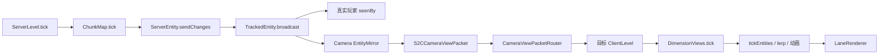

# 相机视图实体活性（服务端跟踪镜像 + 客户端目标世界 tick）

> 状态：H 轮 H10 设计稿（未实现）。F 轮已关单，本方案是 0.3.6 的下一项，不另开版本桶。
> 范围：相机播放期间，同维度 F6 与跨维度 F8 的实体在相机画面里持续移动、转向、播放原版动画。
> 关联：[cross-dimension-camera](../F-playback/cross-dimension-camera.md)、[camera-center-entities](../F-playback/camera-center-entities.md)、[multi-camera-rendering](../F-playback/multi-camera-rendering.md)、[camera-pool](../F-playback/camera-pool.md)、[failure-handling-audit](../F-playback/failure-handling-audit.md)。
> 结论先行：**不是给客户端加 AI，也不是给相机造玩家。** 服务端实体已经在跑；缺的是两条链路：
> 1. 服务端原版实体跟踪的持续包没有镜像到相机视图；
> 2. 目标维度的 `ClientLevel` 没有被客户端 tick，插值和动画停住。

---

## 一、摘要

相机画面里的生物现在看起来是静止的：偶尔收到一次更新时位置会变，但不会连续走；末影龙会原地不动，过一会消失，再出现还是不动。这个现象不是末影龙特例，也不是 AI 没跑，而是**相机视图只拿到了实体快照**。

服务端 `ChunkMap` 仍然按原版规则跟踪实体，`ServerEntity.sendChanges()` 每 tick 产出移动、旋转、头部朝向、metadata、装备、乘客等包；但这些包只发给 `ChunkMap$TrackedEntity.seenBy` 里的真实玩家连接。相机视图不在 `seenBy` 里，`CameraViewManager` 又只在实体第一次进入范围时调用一次 `ServerEntity.sendPairingData()`，之后不再同步。

客户端侧还有第二处断点：跨维度视图的 `DimensionView` 只有 `ClientLevel` / `LevelRenderer` / `LightTexture`，没有 tick。目标 `ClientLevel` 的 `tickEntities()` 从未被调用；`LivingEntity` 的 `lerpSteps` 只在 `tick()` 里递减，所以即使服务端发了移动包，目标视图里的实体也不会插值、不会播放动画。

方案因此分成两层：

- **服务端实体镜像**：不复制 AI、不复制跟踪逻辑，只把原版 `TrackedEntity` 已经产出的包镜像给相机视图；
- **客户端目标世界 tick**：对目标 `ClientLevel` 调 `tickEntities()`，让实体插值、动画、末影龙部件正常走。

本方案一次按完整通用方案设计，不设“最小可用集”。落地顺序只用于验收，不缩减范围。

---

## 二、为什么做

### 2.1 现象

- 相机画面里的猪、僵尸、末影人看起来站着不动；
- 偶尔收到更新时，位置会跳一下，说明服务端状态在变；
- 末影龙原地不动，过一会消失，重新出现后仍然不动；
- 相机移动或视图重新配对后，实体又出现在新位置，但仍然不连续运动。

这三个现象指向同一件事：**服务端实体在动，客户端相机视图只有离散快照。**

### 2.2 根因

#### 2.2.1 服务端跟踪是完整的

MC 1.20.1 的服务端实体跟踪链：

```text
ServerLevel.tick()
  → ChunkMap.tick()
    → 对每个 ChunkMap$TrackedEntity
      → 若实体所在区块在 entity-ticking 范围，或实体换了 section
        → TrackedEntity.serverEntity.sendChanges()
          → ServerEntity.broadcast（实际是 TrackedEntity::broadcast）
            → 遍历 TrackedEntity.seenBy 里的 ServerPlayerConnection
              → 发送移动 / 旋转 / 头部 / metadata / 装备 / 乘客 / 属性等包
```

`CameraViewManager` 已经为目标维度建了相机 ticket：

- `DistanceManager.addPlayer(相机 section, 真实玩家)`；
- ticket level = `ENTITY_TICKING(31) - simulationDistance`，默认 21；
- 每 tick `level.resetEmptyTime()`。

所以服务端实体大概率在 tick、在移动；这一点仍要用探针确认，不能只靠推断。

#### 2.2.2 相机视图不在 `seenBy` 里

`CameraViewManager.sendEntities()` 目前对每个新实体做的是：

```text
new ServerEntity(level, entity, 20, true, broadcast)
  .sendPairingData(player, packet -> sendEnvelope(...))
```

它只发**初始配对**，没有调用 `sendChanges()`。`ChunkMap$TrackedEntity.broadcast()` 只遍历 `seenBy`，相机视图没有注册进去，所以后续包一个都收不到。

这就是“偶尔有更新时位置会变”的原因：那个更新来自重新配对 / 重新进入范围，不是持续同步。

#### 2.2.3 目标 `ClientLevel` 没有 tick

跨维度视图 `DimensionView` 持有独立的 `ClientLevel`，但没有 tick 入口；`DimensionViews` 也没有 tick 循环。目标 `ClientLevel.tickEntities()` 从未被调用。

而客户端实体的插值依赖 tick：

- `LivingEntity.lerpTo()` 只写入 `lerpX / lerpY / lerpZ / lerpSteps`；
- `LivingEntity.tick()` 每 tick 递减 `lerpSteps`，按步长把实体推向目标位置；
- `Entity.tickCount`、动画状态、末影龙部件也都依赖客户端 tick。

没有 tick，实体就会停在旧位置；即使服务端包到了，也只是改内部目标值，不会连续运动。

#### 2.2.4 末影龙不是特例

末影龙由 `EnderDragon` + 多个 `EnderDragonPart` 组成，移动幅度大时服务端会用 `ClientboundTeleportEntityPacket`，部件也有自己的实体数据包。它的“原地不动 → 消失 → 重现仍不动”与普通生物是同一套问题：

- 初始配对只给一次位置；
- 龙的移动 / 传送 / 部件包没有镜像；
- 目标 `ClientLevel` 不 tick，龙的客户端动画和部件也不走；
- 视图范围刷新或实体重新配对时，龙会“消失再出现”，但仍然是新快照。

因此不需要给末影龙写特殊同步；通用镜像 + 客户端 tick 就能覆盖。

#### 2.2.5 AI 不是本方案的修改对象

用户要求是“正常的各自游走 AI”，不是让生物把相机当玩家追。原版 `RandomStrollGoal` 本身不需要玩家；只要服务端实体在 tick，游走就会发生。

本方案**不改 goal selector、不改 `getNearestPlayer` 的 AI 语义、不注册假玩家**。相机锚点虚拟玩家继续只服务刷怪 / 消失判定，不扩展成 AI 目标。

> 原版 `Mob.serverAiStep()` 会累加 `noActionTime`；`checkDespawn()` 只在距最近玩家 32 格内清零。相机在 32–64 格时，远处生物的随机游走可能因 `noActionTime >= 100` 而停。这是原版 AI 口径，不是本方案的同步问题；如果产品要求 64 格内也必须持续游走，另立“AI 观察者语义”议题，不和本方案混合。

### 2.3 目标

- 相机视图里的实体连续移动、转向、播放原版动画；
- 同维度 F6 与跨维度 F8 都成立；
- 覆盖原版与模组实体的标准同步：移动、旋转、头部、metadata、装备、属性、乘客、拴绳、弹射物、掉落物、末影龙部件；
- 不复制 AI，不复制原版跟踪逻辑，不注册假玩家；
- 不影响真实玩家在目标维度的原版跟踪；
- 多视图、多玩家、视图结束 / 重播 / 断线 / 维度卸载都不留残留；
- 性能可测、可解释，不靠拍脑袋限流。

### 2.4 非目标

- 不把相机当玩家：不让怪物以相机为目标、不改变仇恨 / 攻击 / 交互；
- 不接管方块、光照、声音、天气、粒子、方块实体动画的完整同步；
- 不实现 `FABULOUS`、光影 per-pipeline、shadow per-view；
- 不自定义实体包集合，不绕过 `ServerEntity` 重写一套跟踪；
- 不支持模组实体自己绕开原版 `ServerEntity` 的私有网络包；
- 不改编辑器预览的实体语义。

---

## 三、方案

### 3.1 总体架构



两条新增链路：

1. **EntityMirror**：在 `TrackedEntity.broadcast()` 的尾部把同一批包镜像给相机实体流；
2. **ClientViewTicker**：客户端每 tick 对目标 `ClientLevel` 调 `tickEntities()`。

不新增 AI tick，不新增假玩家，不改变原版 `seenBy`。

### 3.2 服务端：镜像原版跟踪，不复制 AI

#### 3.2.1 实体流身份

实体流按 **`(玩家 UUID, 目标维度)`** 建，而不是按 lane / view 建。

原因：

- 同一玩家同一目标维度只有一份客户端 `ClientLevel`（`DimensionViews` 按维度共享）；
- 多条同维度 lane 不应该重复发 `AddEntity` / 移动包；
- 视图只是实体流的订阅者，订阅数归零才释放。

```text
EntityStream
  playerUuid
  ServerLevel level
  ResourceLocation dimension
  Set<ViewKey> subscribers
  Map<Integer, EntityInterest> entities
  String envelopeViewId        // 用于 S2CCameraViewPacket 的视图标签；取任一活跃订阅
```

`EntityInterest` 记录：

- `Entity` 引用 / 实体 id；
- 每个订阅 view 是否还需要它（引用计数）；
- 是否已配对（防止重复 `sendPairingData`）；
- 上次范围检查 tick。

**同维度 F6 不经过 `EntityStream`。** F6 的主画面就是玩家自己的 `ClientLevel`，实体包走真实 `seenBy`，原版跟踪和客户端 tick 都是现成的。若 F6 里也看不到实体运动，问题在服务端 tick / 原版跟踪，不在跨维度镜像；用 §4.9 的探针查，不能用镜像掩盖。

#### 3.2.2 初始配对

新实体第一次进入某个视图的实体范围时：

- 沿用现有 `new ServerEntity(level, entity, 20, true, consumer).sendPairingData(player, consumer)`；
- 包经 `S2CCameraViewPacket` 信封发到目标 `DimensionView`；
- 配对成功后把实体加入 `EntityStream`，登记订阅；
- **不调用 `sendChanges()`**，不持有会修改 `hasImpulse` / dirty data 的第二个 `ServerEntity`。

初始配对只做一次；多个视图订阅同一实体时复用。

#### 3.2.3 持续更新

在 `ChunkMap$TrackedEntity.broadcast(Packet)` 的 `TAIL` 注入：

```text
CameraViewManager.INSTANCE.mirrorTrackedEntityPacket(entity.getId(), packet)
```

`mirrorTrackedEntityPacket`：

- 找到该实体所属的 `EntityStream`；
- 只发给当前订阅了该实体的视图 / 连接；
- 用现有 `sendEnvelope` 编码进 `S2CCameraViewPacket`；
- 不修改原版 `seenBy`，不影响真实玩家；
- 单包异常只丢本包，不打断原版 `broadcast`。

这样能覆盖 `ServerEntity` 产出的全部标准包，而不是手写一个子集：

- `ClientboundAddEntityPacket`（初始配对）；
- `ClientboundSetEntityDataPacket`；
- `ClientboundSetEquipmentPacket`；
- `ClientboundUpdateAttributesPacket`；
- `ClientboundSetPassengersPacket`；
- `ClientboundSetEntityLinkPacket`；
- `ClientboundMoveEntityPacket.Pos / Rot / PosRot`；
- `ClientboundTeleportEntityPacket`；
- `ClientboundRotateHeadPacket`；
- `ClientboundSetEntityMotionPacket`；
- `ClientboundEntityEventPacket` / `ClientboundAnimatePacket` 等经 `broadcast` / `broadcastAndSend` 的包；
- 模组实体通过原版 `SynchedEntityData` / `ServerEntity` 发出的标准包。

#### 3.2.4 移除

相机视图的移除不走 `ServerEntity.removePairing()`（那会直接发给真实玩家连接），由 `EntityStream` 自己发 `ClientboundRemoveEntitiesPacket`。

触发点：

| 触发 | 处理 |
|---|---|
| 实体离开视图范围 | `sendEntities` 差集发现缺失 → 取消订阅；最后一个订阅者移除时发 remove |
| 视图结束 / 重播 / 租约归还 | 取消该 view 的全部订阅；最后一个订阅者移除时发 remove |
| 实体被移除 / 死亡 / 卸载 | `TrackedEntity.broadcastRemoved` HEAD 通知 `EntityStream` → 给所有订阅者发 remove，清实体 |
| 区块卸载 / 实体换维度 | 同上；旧维度流移除，新维度重新配对 |
| 玩家进入目标维度 | `CameraViewManager` 释放该维度视图；交还原版追踪，避免重复配对 |
| 玩家断线 / 服务端停止 / 维度卸载 | 清流，不再发包 |

#### 3.2.5 为什么不用 `seenBy` 合成连接

一个可选方案是给每个视图造一个 `ServerPlayerConnection` 塞进 `TrackedEntity.seenBy`。它能复用原版 `sendChanges`，但有几个硬问题：

- `broadcastRemoved()` 会对每个 `seenBy` 调 `ServerEntity.removePairing(connection.getPlayer())`，remove 包会直接发到真实玩家连接；
- `seenBy` 是原版真实玩家集合，混入非玩家连接会改变原版语义；
- 多视图 / 多玩家 / 玩家进入目标维度时，连接的生命周期和去重很容易出错；
- 需要额外的假 `ServerPlayer` 或复杂的移除拦截。

镜像方案不碰 `seenBy`，只旁路复制包；原版跟踪保持原样，兼容性和故障面都更小。

也不建议给每个视图新建第二个 `ServerEntity` 并调用 `sendChanges()`：`sendChanges()` 会清 `entity.hasImpulse`、消费 `SynchedEntityData` 的 dirty 状态，等于和原版跟踪抢同一份状态；多视图时谁先调用谁就改变原版的更新节奏。镜像原始包不碰这些状态。

### 3.3 客户端：目标世界实体 tick

#### 3.3.1 tick 入口

在客户端 tick 的固定位置调用：

```text
DimensionViews.tick(Minecraft)
  → 对每个已获取的目标 DimensionView
    → view.level().tickEntities()
```

`ClientLevel.tickEntities()` 会：

- 遍历 `tickingEntities`，对非乘客实体 `tickNonPassenger()`；
- `setOldPosAndRot()`、`tickCount++`、`Entity.tick()`；
- 处理乘客 `rideTick()`；
- 最后 `tickBlockEntities()`。

这正是 `LivingEntity.lerpSteps`、动画状态、末影龙部件需要的客户端 tick。

#### 3.3.2 不 tick 整个 `ClientLevel`

只调 `tickEntities()`，不调 `ClientLevel.tick()`：

- 不推进目标维度时间 / 天气；
- 不 tick 区块随机刻 / 方块 tick；
- 不触发目标维度世界级逻辑；
- 避免和主世界时间、天气、游戏规则产生第二套状态。

目标视图仍然是“渲染 + 实体表现”的只读世界；方块 / 光照 / 声音的完整同步不在本方案。

#### 3.3.3 执行顺序

每个客户端 tick：

1. 网络包处理（`CameraViewPacketRouter` 把实体包送进目标 `ClientLevel`）；
2. `DimensionViews.tick()`；
3. 渲染帧（`LaneRenderer` 用目标 `DimensionView`）。

这样同一 tick 收到的移动包会先进入 `lerpTo`，再由 `tickEntities` 推进插值，渲染时不会慢一帧。

#### 3.3.4 异常隔离

- 每个 `DimensionView` 的 `tickEntities` 单独 `try/catch`；
- 失败限频记录，只跳过该视图本 tick，不影响主世界 / 其他视图；
- 连续失败或视图已关闭时停止 tick，避免每帧刷屏；
- `Error` / GL 上下文丢失等致命错误按现有 `FatalErrors` 口径上抛。

### 3.4 实体流生命周期

```text
视图创建 / 首次上报
  → 订阅 EntityStream
  → 范围内新实体：sendPairingData → 加入 sentEntities

视图移动
  → 重新计算范围内实体
  → 新实体：pairing
  → 离开实体：取消订阅；最后一个订阅者移除时 remove

视图结束 / 租约归还
  → 取消该视图全部订阅
  → 最后一个订阅者移除时 remove 全部实体
  → 删除空 EntityStream

实体被移除 / 区块卸载 / 换维度
  → broadcastRemoved / removeEntity 通知
  → 所有订阅者 remove
  → 清实体记录

玩家进入目标维度 / 断线 / 服务端停止 / 维度卸载
  → 释放视图 / 清流
  → 不再发包
```

关键不变量：

- 一个 `(玩家, 维度, 实体)` 只配对一次；
- 一个 `(玩家, 维度)` 的实体包只发一次，不按 lane 重复；
- 最后一个订阅者离开才发 remove；
- 视图结束不误删其他视图仍在用的实体；
- 真实玩家进入目标维度后，相机流让位，原版跟踪接管。

### 3.5 多视图 / 多玩家 / 同维度

- **同一玩家、同一维度多条 lane**：共享一个 `EntityStream` 和一份 `ClientLevel`；实体只配对一次、更新一次；每个 lane 只是订阅者。
- **同一玩家、不同维度**：不同 `EntityStream`，各自 `DimensionView`。
- **多个玩家**：流按玩家 UUID 隔离，包只发到各自连接，不交叉。
- **玩家真实进入目标维度**：`CameraViewManager` 现有逻辑会释放该视图；实体流同时释放，避免和原版 `seenBy` 重复。
- **同一维度多个视图范围不同**：实体集合取并集；每个实体记录哪些视图还需要它，最后一个视图不需要时才 remove。客户端只有一份 `ClientLevel`，并集是合理口径。

### 3.6 AI 语义

本方案只保证“原版 AI 在跑，并且相机看得见”，不改变 AI 做什么：

- 保留原版 `goalSelector` / `targetSelector`；
- 不把相机加入 `getNearestPlayer` 的 AI 目标；
- 不注册假 `ServerPlayer`；
- 不修改刷怪 / 消失判定；
- 现有 `CameraAnchorVirtualPlayer` 继续只用于刷怪门、消失判定和诊断，不扩展成“相机玩家”。

因此：

- 猪、羊、僵尸会按原版随机游走；
- 僵尸不会因为相机在附近就追相机；
- 骷髅不会把相机当靶子；
- 如果某类生物的原版 AI 本身需要玩家，它仍然不会因为相机而启动——这是语义选择，不是同步缺陷。

---

## 四、技术细节

### 4.1 服务端注入点

目标类：`net.minecraft.server.level.ChunkMap$TrackedEntity`（包私有内部类，字符串 target）。

需要的注入：

1. `broadcast(Packet)` TAIL
   读取 `TrackedEntity.entity`，调用 `CameraViewManager.mirrorTrackedEntityPacket(entityId, packet)`。

2. `broadcastRemoved()` HEAD
   读取 `TrackedEntity.entity`，调用 `CameraViewManager.onTrackedEntityRemoved(entityId)`；之后原版继续对真实玩家发 remove。

3. 可选：`ChunkMap.removeEntity(Entity)` HEAD/TAIL
   作为 `broadcastRemoved` 之外的兜底；两者只做幂等清理，不重复发 remove。

不需要改 `TrackedEntity.updatePlayer`、`seenBy`、`ServerEntity.sendChanges`。

### 4.2 初始配对

沿用现有 `CameraViewManager.sendEntities` 的 `ServerEntity.sendPairingData`：

- 它发送 `AddEntity`、初始 metadata、装备、属性、乘客、拴绳等完整配对数据；
- 它不修改 `hasImpulse` / dirty data；
- 它不注册 `seenBy`；
- 它只用于初始状态，后续交给镜像。

配对顺序：

1. 确认实体在目标 `ServerLevel` 且未被移除；
2. 确认实体不在 `EntityStream.sentEntities`；
3. 发送 `sendPairingData`；
4. 加入 `sentEntities` / 订阅计数；
5. 后续 `broadcast` 镜像开始生效。

如果在 3 和 5 之间发生一次更新，最坏情况是这一帧少一个包；下一次 `sendChanges` 会补位置 / 旋转，metadata 变化也会在下一次 dirty 时补。配对与注册应尽量在同一主线程 tick 内完成，避免窗口。

### 4.3 更新包

镜像的是 `TrackedEntity.broadcast` 收到的原始 `Packet<?>`，不重新构造包、不筛选包类型。

这样做的原因：

- 原版 `ServerEntity` 已经处理了 update interval、位置编码、传送阈值、头部旋转、metadata dirty、装备、乘客、属性；
- 手写子集一定会漏掉模组实体或未来版本新增包；
- 镜像原始包可以保持与真实玩家完全相同的语义。

需要保证：

- 包只发给订阅了该实体的 `EntityStream`；
- 同一个 `(玩家, 维度)` 只发一次；
- 使用现有 `sendEnvelope`，保留 1 MiB 上限和异常降级；
- 不在镜像里调用会改变实体状态的方法。

### 4.4 客户端 tick

`DimensionViews` 增加：

- `tick(Minecraft)`：遍历所有非 `MAIN` 的目标视图；
- 每个视图独立异常隔离；
- 只对 `view.level()` 调 `tickEntities()`；
- 视图关闭后从 tick 集合移除。

调用点放在客户端 tick 的固定阶段（与 `CameraViewReporter` 同阶段即可），确保在网络包处理之后、渲染之前。

需要验证：

- `LivingEntity.lerpSteps` 正常递减；
- `Entity.tickCount` 增长；
- 乘客 / 坐骑动画正常；
- 末影龙部件跟随；
- 目标 `ClientLevel` 的 block entity tick 不产生主世界副作用。

### 4.5 末影龙

不写龙特例，按通用实体处理：

- `EnderDragon` 是 `Mob`，标准 `ServerEntity` 跟踪；
- `EnderDragonPart` 是独立实体，标准实体包；
- 大位移会走 `ClientboundTeleportEntityPacket`，镜像；
- 客户端 `tickEntities` 让龙和部件播放原版动画；
- “消失再出现”由视图范围 / 重新配对解释，实体流引用计数保证不会因为一个视图释放而误删其他视图的龙。

验收时单独跑末影龙场景，但实现不出现 `if (entity instanceof EnderDragon)`。

### 4.6 兼容性

| 场景 | 处理 |
|---|---|
| 原版生物 / 动物 / 怪物 | 标准 `ServerEntity` 包，直接覆盖 |
| 模组实体（标准 `SynchedEntityData`） | 同样走 `ServerEntity`，直接覆盖 |
| 模组实体私有网络包 | 不走 `ServerEntity` 的部分不在本方案；不拦截、不伪造 |
| 乘客 / 坐骑 / 拴绳 | 初始配对 + `SetPassengers` / `SetEntityLink` 镜像 |
| 弹射物 / 掉落物 / TNT / 船 | 标准实体包 |
| 物品展示框 / 地图 | 标准实体包；地图数据包不在本方案 |
| 末影龙 / 多部件 Boss | 标准实体包 + 部件实体；不特判 |
| 模组维度 | 沿用 `DimensionView` 的维度元数据与路由 |
| 多玩家 | 流按玩家隔离 |
| 玩家真实进入目标维度 | 释放相机流，原版追踪接管 |
| Iris / Oculus / Sodium / Embeddium | 实体包和客户端 tick 不改变光影 / 渲染状态；目标视图仍走现有 `DimensionView` |
| `FABULOUS` | 仍拒绝目标视图；不在本方案扩展 |

### 4.7 性能

新增成本：

- **服务端**：每个实体更新包多一次 `sendEnvelope` 编码 / 发送；不新增 AI tick，不新增实体跟踪；
- **客户端**：目标 `ClientLevel.tickEntities()` 的实体 tick；不 tick 区块 / 世界；
- **网络**：每个 `(玩家, 维度)` 一份实体包，不按 lane 重复。

测量项：

- 2 / 3 条 lane、目标维度 32 / 64 格实体数量下的包量 / tick；
- 客户端 tick 耗时（目标视图实体数 vs 主世界）；
- 末影龙 / 大量掉落物 / 弹射物的极端场景；
- 多玩家同时观看同一维度。

不在没有数据前硬编码实体上限；如果包量过高，优先做**每 tick 合并 / 批量信封**，而不是改变同步语义。

### 4.8 失败处理

- 镜像注入整体 `try/catch`：异常只记录，不影响原版 `broadcast`；
- `sendEnvelope` 失败：单包丢弃，限频日志；
- 目标实体在镜像时已被移除：忽略并清理订阅；
- 客户端 `tickEntities` 单视图异常：跳过该视图本 tick，连续失败停止 tick 并记录；
- 视图关闭 / 维度卸载 / 玩家断线：清流，不继续发包；
- 不把异常吞成静默：日志带玩家、维度、实体 id、包类型。

### 4.9 服务端 tick 探针

镜像和客户端 tick 只能解决“服务端在动、客户端没收到 / 没 tick”；如果服务端实体本身没 tick，必须先定位。

探针输出（debug 开关下，限频）：

- 实体 id / 类型 / 维度；
- `tickCount`；
- 当前 `position` 与上一采样位置差；
- `deltaMovement`；
- `noActionTime`；
- `isNoAi()`；
- `inEntityTickingRange(chunkPos)`；
- `ServerLevel.entityTickList.contains(entity)`（如可访问）；
- 所在 chunk 的 `FullChunkStatus`；
- `ServerLevel.emptyTime`（如可访问）。

判定：

| 现象 | 结论 |
|---|---|
| `tickCount` 增长、位置变化、客户端不动 | 镜像 / 客户端 tick 问题 |
| `tickCount` 增长、位置不变、`noActionTime` 很高 | AI 目标 / 游走条件问题，不是同步 |
| `tickCount` 不变、`inEntityTickingRange=false` | ticket / entity-ticking 问题 |
| `tickCount` 不变、`inEntityTickingRange=true` | 实体不在 tick list / 区块状态异常 |

如果确认是 ticket 问题，修法是让相机 section 的 `ChunkHolder` 达到 `FullChunkStatus.ENTITY_TICKING`：

- 优先沿用 `DistanceManager.addPlayer` 的现有 ticket；
- 若 `simulationDistance` / section 变化导致级别不够，补一个明确等级的 ticket（与视图释放严格配对）；
- 仍然不注册假 `ServerPlayer`，不把相机写进玩家列表。

### 4.10 落地顺序与交付物

以下全部属于同一轮完整方案，不设“只做一半”的发布：

1. **服务端镜像**
   - `ChunkMap$TrackedEntity.broadcast` / `broadcastRemoved` 注入；
   - `EntityStream`（按玩家 + 维度）与订阅计数；
   - `CameraViewManager` 初始配对改为订阅式；
   - 单包异常 / 限频日志。
2. **客户端 tick**
   - `DimensionViews.tick()`；
   - 目标 `ClientLevel.tickEntities()`；
   - 视图异常隔离与关闭清理。
3. **探针与 fixture**
   - 服务端 `tickCount` / `inEntityTickingRange` / `noActionTime` 日志；
   - 客户端 `lerpSteps` / `tickCount` 日志；
   - 普通生物、末影龙、同维度 F6、多视图、断线 / 重播 fixture。
4. **性能与收口**
   - 包量 / 客户端 tick 耗时测量；
   - 批量发送只在数据证明需要时引入；
   - 文档回写 F8 已知限制与下一轮验收结果。

验收顺序不等于范围裁剪：第 1、2 步都完成后才宣称实体活性通过；探针只用于定位，不作为长期行为。

---

## 五、验收矩阵

| # | 场景 | 观察点 | 通过标准 |
|---|---|---|---|
| 1 | 目标维度猪 / 僵尸，相机固定 | 服务端 `tickCount` / position；客户端 position / `lerpSteps` | 服务端和客户端位置连续变化；动画不冻结 |
| 2 | 目标维度末影龙 | 龙本体、部件、传送、消失 / 重现 | 龙连续移动 / 转向 / 动画；不因视图刷新变回快照 |
| 3 | 同维度 F6 相机中心 | 生物是否连续运动 | 与 F8 一致；若 F6 已正常，作为回归 |
| 4 | 实体进入 / 离开 64 格 | 配对、remove、重新配对 | 不出现幽灵实体；不重复 `AddEntity` |
| 5 | 视图结束 / 重播 / 租约归还 | 实体流、`sentEntities` | 全部 remove；无残留订阅 |
| 6 | 玩家断线 / 维度卸载 / 服务端停止 | 服务端状态 | 流清空；无异常包 |
| 7 | 同维度两条 lane | 包量、实体状态 | 只配对一次、只更新一次；共享 `ClientLevel` 正常 |
| 8 | 两个玩家看同一目标维度 | 各自连接 | 互不串包；各自释放不影响对方 |
| 9 | 玩家真实进入目标维度 | 相机流 / 原版追踪 | 相机流让位；无重复实体 |
| 10 | 模组实体（标准同步） | 位置 / metadata / 装备 | 与真实玩家视角一致 |
| 11 | 大量实体 / 弹射物 / 掉落物 | 包量、客户端 tick 耗时 | 可解释、无持续增长；必要时批量优化 |
| 12 | 光影开启 | 目标视图渲染 | 实体更新不影响光影状态；无崩溃 |

补充验收：

- 服务端探针必须能回答：实体是否 `inEntityTickingRange`、`entityTickList` 是否包含、`tickCount` 是否增长、`noActionTime` 是否增长；
- 客户端探针必须能回答：实体是否收到移动包、`lerpSteps` 是否递减、`tickCount` 是否增长；
- 任何一项失败，先定位是“服务端没 tick”“包没镜像”“客户端没 tick”中的哪一层，不混在一起修。

---

## 六、不做什么 / 开放问题

### 6.1 不做什么

- 不把相机注册成玩家 / 假玩家；
- 不修改 AI goal / target selector；
- 不让怪物以相机为目标；
- 不接管方块 / 光照 / 声音 / 天气 / 粒子；
- 不实现 `FABULOUS` / shadow per-view / 光影 per-pipeline；
- 不手写实体包白名单；
- 不支持模组实体绕过原版 `ServerEntity` 的私有包；
- 不做“只让末影龙动”的特判。

### 6.2 开放问题

1. **实体流粒度**：按 `(玩家, 维度)` 共享，还是按 view 独立？
   本文选 `(玩家, 维度)`；如果同一维度多条 lane 范围差异很大，需要测量并集成本。

2. **目标视图 tick 范围**：所有已获取视图都 tick，还是只 tick 当前帧有 lane 使用的视图？
   本文倾向所有活跃实体流对应的视图都 tick；预取景但完全不可见的视图是否 tick，需要性能数据决定。

3. **`noActionTime` 与 32–64 格**：原版只在 32 格内清零；相机在更远处时随机游走可能停。
   这是原版 AI 口径，本文不改；如果产品要求 64 格内持续游走，另立“相机观察者半径”议题。

4. **包合并**：实体很多时是否需要每 tick 批量信封？
   先测，再决定；不在功能方案里提前引入复杂批处理。

5. **模组私有实体包**：是否需要提供扩展 API 让模组把自己的包也镜像？
   本文不承诺；先保证原版 `ServerEntity` 标准链。

---

## 附录：证据索引

### 本仓代码

- `common/src/main/java/com/immersivecinematics/immersive_cinematics/trigger/server/CameraViewManager.java`
  - `sendEntities`：只调用 `ServerEntity.sendPairingData`，没有 `sendChanges`；
  - `handle` / `tick`：`DistanceManager.addPlayer`、`level.resetEmptyTime()`；
  - `sendEnvelope`：现有相机视图信封与 1 MiB 上限；
  - `ViewState.sentEntities`：现有实体集合。
- `common/src/main/java/com/immersivecinematics/immersive_cinematics/client/dimension/DimensionView.java`
  - 只有 `ClientLevel` / `LevelRenderer` / `LightTexture`，没有 tick。
- `common/src/main/java/com/immersivecinematics/immersive_cinematics/client/dimension/DimensionViews.java`
  - 没有 tick 循环；只有 acquire / close / resize / reload。
- `common/src/main/java/com/immersivecinematics/immersive_cinematics/trigger/client/CameraViewPacketRouter.java`
  - 只处理包路由，不 tick 目标世界。
- `common/src/main/java/com/immersivecinematics/immersive_cinematics/mixin/ChunkMapCameraMixin.java`
  - 同维度 F6 的虚拟中心。
- `common/src/main/java/com/immersivecinematics/immersive_cinematics/mixin/MobDespawnCameraMixin.java`
  - 消失判定的虚拟玩家；不参与 AI 目标。

### MC 1.20.1 / Forge 47.4.16

- `net.minecraft.server.level.ChunkMap#tick`
  - 对 `TrackedEntity` 调 `serverEntity.sendChanges()`；条件包含 `inEntityTickingRange`。
- `net.minecraft.server.level.ChunkMap$TrackedEntity#broadcast`
  - 只遍历 `seenBy` 的 `ServerPlayerConnection`。
- `net.minecraft.server.level.ChunkMap$TrackedEntity#broadcastRemoved`
  - 对 `seenBy` 逐个 `removePairing`。
- `net.minecraft.server.level.ServerEntity#sendChanges`
  - 产出移动 / 旋转 / 头部 / metadata / 装备 / 乘客 / 属性 / motion 等包；会清 `hasImpulse`。
- `net.minecraft.client.multiplayer.ClientLevel#tickEntities`
  - 遍历 `tickingEntities`，调 `tickNonPassenger` / `tickPassenger`，再 `tickBlockEntities`。
- `net.minecraft.world.entity.LivingEntity#tick` / `lerpTo`
  - `lerpSteps` 在 tick 中递减；没有 tick 就不会插值。
- `net.minecraft.world.entity.Mob#serverAiStep` / `checkDespawn`
  - `noActionTime` 累加；32 格内最近玩家清零。
- `net.minecraft.world.entity.boss.enderdragon.EnderDragon` / `EnderDragonPart`
  - 多部件实体，标准实体包 + 客户端 tick。
