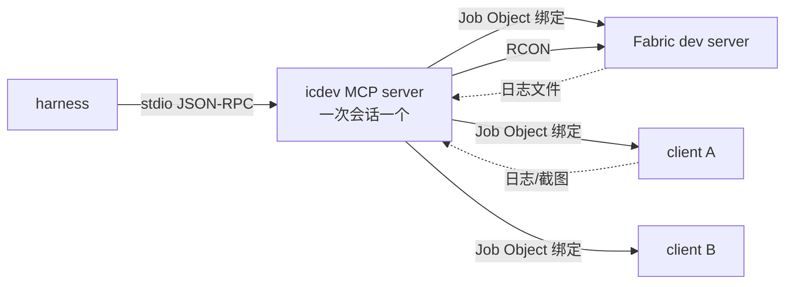
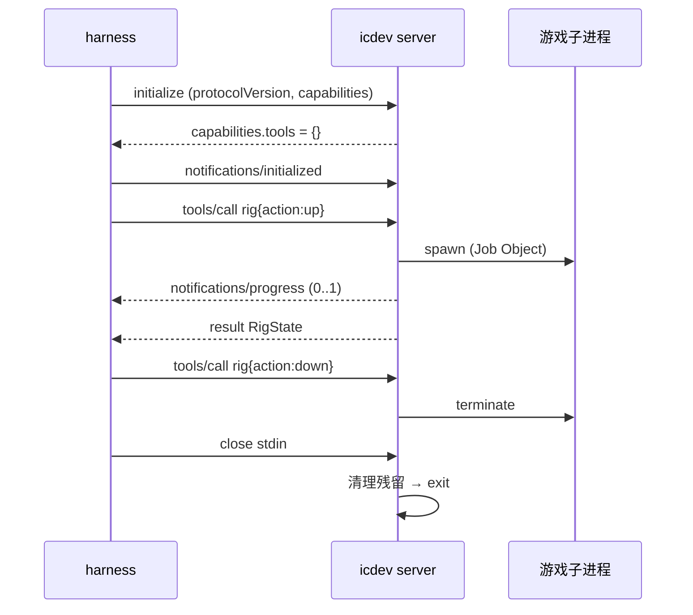

# devtools MCP 化设计（icdev）

> 状态：**设计稿**（未实现）。目标是一次性替换现有 CLI 的入口层，不做多版并存。
> 依据：MCP 规范 **2025-06-18**（`basic/lifecycle`、`basic/transports`、`server/tools`）。
> 现有入口：`tools/devtools/devtools.py`（20 个子命令，每次调用一个新进程）。

---

## 一、为什么做

本轮（H-6）实测暴露的问题，全部是「装置没有主人」导致的：

| 现象 | 直接原因 | 现在怎么绕过 |
|---|---|---|
| 第二个客户端起不来 | 同项目并发 `gradlew` 抢构建锁 | 手工 dump classpath + `java -cp` 直启 |
| 两客户端互相顶下线（「异地登录」） | dev 客户端随机取名，撞名 | 手工加 `--username` |
| **两次把服务端杀掉** | 按 `devlaunchinjector` 过滤，服务端客户端同前缀 | 手工改成 `KnotClient` / `KnotServer` |
| 长按投票做不了 | `key` 只支持单击 | 临时写 `hold_key.py` |
| 服务端命令没入口 | 没有 RCON | 临时写 `rcon.py` |
| 命令静默失败 | 目标维度区块未加载，`kill @e` 报「No entity was found」 | 人肉判断 |
| 配置改来改去忘了还原 | 手改 JSON | 手写 `RESTORE.md` |

共性是：**每个操作都是独立进程，没人知道「现在有哪些进程、哪个装置是活的、哪个配置被改过」**。

MCP 解决的就是这一层：一个会话一个常驻 server 进程，装置状态（pid / 端口 / run dir / rcon 连接 / 配置快照）是内存里的对象。

**MCP 不解决**：判据本身（像素、包量结论）、夹具内容、第三方模组兼容。

---

## 二、非目标

- **不做跨会话常驻**。MCP 里没有这个概念：stdio 下 server 是 client 的子进程，会话结束即退出（规范 `basic/lifecycle#shutdown`）。
- **不做 Streamable HTTP**。规范里它是给「独立进程、多连接」的场景；本项目是一台机器、一次开发会话，stdio 足够，且规范明确 *clients SHOULD support stdio whenever possible*。
- 不做 `resources` / `prompts` / `sampling` / `elicitation`。工具足够，不扩张能力面。
- 不做通用游戏自动化（寻路、GUI 导航、自动建世界）。
- 不做跨平台：Win32 定向消息 + 进程枚举是 Windows 专属，非 Windows 直接 `E_UNSUPPORTED`。
- 不做通用计算机视觉：只保留「亮像素簇 / 包围盒 / 两图差异」。

---

## 三、规范依据（2025-06-18）

| 规范条文 | 对本设计的影响 |
|---|---|
| 生命周期三段：`initialize` → `initialized` → operation → shutdown | server 在 `initialize` 时声明能力，`initialized` 之后才处理工具调用 |
| stdio：client 启动 server 子进程，JSON-RPC 逐行（消息内不得含换行） | 子进程 stdout/stderr 必须重定向到文件 |
| stdio：**server MUST NOT 向 stdout 写任何非 MCP 消息** | 库里禁止 `print()`；日志走 `stderr` 或 `notifications/message` |
| stdio shutdown：client 关闭 stdin → server 退出；超时 SIGTERM → SIGKILL | server 在 stdin EOF 时必须先清理子进程再退出 |
| `server MUST declare the tools capability` | `initialize` 响应里带 `capabilities.tools = {}`（不做 `listChanged`，工具集静态） |
| 工具定义：`name` / `title` / `description` / `inputSchema` / `outputSchema?` / `annotations?` | 每个工具独立声明，**不是**把目录塞进一个 `call_tool` |
| 工具结果：`content[]` + 可选 `structuredContent` | 结构化结果同时给 `structuredContent`（配 `outputSchema`）与一段文本摘要 |
| 错误分两类：协议错误（JSON-RPC error）与工具执行错误（`isError: true`） | 未知工具/参数非法走 `-32602`；运行期失败走 `isError` |
| `notifications/progress`、`notifications/cancelled` | `rig_up`（最长 180 s）必须发进度；取消要回滚已起的进程 |
| `notifications/message`（logging capability） | 装置日志、就绪过程通过 logging 通知推送 |
| 安全：servers MUST validate all tool inputs / 实现访问控制 / 限流 | 参数白名单；`kill` 只认自有进程；单会话单装置 |

---

## 四、架构



三条结构性结论：

1. **MCP server 进程 = 会话 = 装置宿主**。没有「继承上一次会话的装置」这回事；启动时把内存状态当作空的，只做一件事：如果用户希望看到遗留进程，`process(list)` 会把**非自有**的 Minecraft 进程标出来（`owned: false`），但不会去接管。
2. **所有游戏进程都是 server 的子进程**，并且加入同一个 **Windows Job Object**（`JOB_OBJECT_LIMIT_KILL_ON_JOB_CLOSE`）。这样即使 harness 直接 `SIGKILL` 掉 server（钩子不执行），操作系统也会把整棵子进程树一起终止——不留幽灵进程。
3. **CLI 与 MCP 共用同一个 `icdev` 库**，CLI 只做参数解析。

---

## 五、决策（已定）

| # | 决策 | 取值 | 依据 / 理由 |
|---|---|---|---|
| D1 | 传输 | **只 stdio** | 规范：clients SHOULD support stdio；HTTP 面向独立进程多连接，本项目不需要 |
| D2 | 工具暴露 | **标准 `tools/list`**：8 个语义化工具，内部用 `action` 枚举分派 | 既保留规范要求的「每工具独立 schema + annotations」，又不让 28 个工具把上下文吃满 |
| D3 | 生命周期 | **会话即装置**：stdin EOF / `SIGTERM` → `rig_down` → 退出 | 规范 shutdown 语义；不含 detach/收养 |
| D4 | 进程回收 | Windows **Job Object** + 正常路径显式 `rig_down` 双保险 | `SIGKILL` 时钩子不跑，必须靠内核兜底 |
| D5 | 进程所有权 | 只杀自己 spawn 的 `(pid, 创建时间, cmdline 哈希)` 三元组 | 本轮误杀两次的直接修复 |
| D6 | 就绪判定 | 日志正则 + 超时 + 进度通知，不用固定 `sleep` | 启动 25–180 s 波动大 |
| D7 | 装置数量 | 每会话 1 个装置；重复 `rig_up` 返回 `E_ALREADY_UP` + 现有状态 | 端口 / run dir / 窗口标题都会打架 |
| D8 | 依赖 | 去掉 `pyautogui`（改 ctypes `EnumWindows`）；加 `numpy`、`mcp` | pyautogui 只用来枚举窗口 |
| D9 | CLI | 保留，命令名与参数不变，内部调 `icdev` | 人工排查与 CI 仍要用 |

---

## 六、目录与模块

```
tools/devtools/
├── icdev/
│   ├── __init__.py
│   ├── win32.py        # EnumWindows / PostMessage / 键鼠 / Job Object
│   ├── process.py      # 进程枚举、所有权三元组、spawn/kill
│   ├── rig.py          # Rig 状态机、装置起停、就绪断言、进度回调
│   ├── launch.py       # loom classpath 导出与缓存、java 直启
│   ├── rcon.py         # RCON 客户端（连接复用）
│   ├── logs.py         # tail / trace / 正则等待
│   ├── config.py       # immersive_cinematics.json 读写（带校验）
│   ├── snapshot.py     # run dir 脚本/配置快照与还原
│   ├── pixels.py       # 亮像素簇 / 包围盒 / 两图差异
│   ├── diag.py         # 诊断会话 manifest 生成与摘要
│   └── server.py       # MCP server：initialize / tools/list / tools/call / 通知
├── devtools.py         # CLI 薄壳
├── mcp.json            # harness 注册片段
├── README.md
└── pyproject.toml
```

`launch.py` 吸收本轮 `dump.gradle` 的做法：导出一次 loom classpath 并缓存（以 `common/build/libs` 的 jar mtime 为失效键），之后直接 `java -cp` 启动，**绕开 gradle 抢锁**。启动前自动 `:common:jar`（增量，几秒）。

---

## 七、工具清单（`tools/list` 返回 10 个通用原语）

设计口径：**工具是原语，不是业务动作**。播放脚本不是 `play(script)`，而是
`input(action="cmd", text="icinematics play <id>")`；玩家列表不是 `players()`，而是
`rcon(action="command", command="list")`。新增业务不需要改工具集。

约定：
- 每个工具 `inputSchema` 为对象，`required: ["action"]`；其余字段按 `action` 在实现内校验。
- 每个工具带 `annotations`：`readOnlyHint` / `destructiveHint` / `idempotentHint` / `openWorldHint`。
- 运行期失败：`isError: true` + `structuredContent {code, message, detail?}`；未知工具 / 未知 action / 参数类型错：JSON-RPC `-32602`。

### 7.1 `rig` — 装置生命周期

| action | 参数 | 返回 |
|---|---|---|
| `up` | `world?`, `clients?: string[]`, `server?: bool`, `shader?`, `debug?: bool`, `dirs?: {server?, clients?: string[]}` | `RigState` |
| `down` | `force?: bool` | `{stopped:[{role,pid}]}` |
| `status` | — | `RigState` |

### 7.2 `process` — 进程

| action | 参数 | 返回 |
|---|---|---|
| `list` | — | `[{role,pid,owned,createdAt,cmdline,port?,players?}]` |
| `kill` | `target:"client"|"server"|"all"`, `name?` | `{stopped:[...]}` |

### 7.3 `input` — 输入

| action | 参数 | 说明 |
|---|---|---|
| `cmd` | `text`, `target?`, `waitMatch?`, `timeoutMs?` | 聊天栏执行命令；`play` / `stop` / `reload` 都走这里 |
| `key` | `key`, `target?` | 单击 |
| `hold` | `key`, `seconds`, `target?` | 长按（投票等） |

### 7.4 `capture` — 取证

| action | 参数 | 返回 |
|---|---|---|
| `shot` | `path?`, `target?`, `region?` | `{path,width,height}` |
| `pixels` | `path`, `mode:"clusters"|"diff"`, `threshold?`, `band?`, `compare?` | 簇 / 差异统计 |

### 7.5 `log` — 日志

| action | 参数 | 返回 |
|---|---|---|
| `tail` | `lines?`, `target?` | 文本（GBK 容错） |
| `trace` | `pattern?`, `lines?`, `out?` | 过滤文本 / 文件路径 |
| `wait` | `pattern`, `timeoutMs?`, `target?` | `{matched, lastLines}` |

### 7.6 `config` — 配置

| action | 参数 | 说明 |
|---|---|---|
| `get` | `key`, `target?` | 读 `immersive_cinematics.json` |
| `set` | `key`, `value`, `target?` | 白名单键 + 类型/范围校验；返回旧值 |

### 7.7 `snapshot` — 运行目录快照

| action | 参数 | 说明 |
|---|---|---|
| `create` | `name`, `targets?: string[]` | 备份脚本/配置 + `manifest.json` |
| `restore` | `name` | 按 manifest 还原（含删除新增文件） |
| `list` | — | 已有快照 |

### 7.8 `rcon` — 服务端命令

| action | 参数 | 说明 |
|---|---|---|
| `command` | `command`, `timeoutMs?` | 连接复用；`list` / `stop` / `icinematics play ... @a` 都走这里 |

### 7.9 `diag` — 诊断会话

| action | 参数 | 说明 |
|---|---|---|
| `manifest` | `cases:[{id,script,lanes,frames,content?}]`, `session?` | 生成 `f-round.json` |
| `perf` | `session?` | 摘要表 |
| `sessions` | `limit?` | 会话列表 |
| `analyze` | `sessionDir` | 结构完整性 |

### 7.10 `info` — 环境

| action | 参数 |
|---|---|
| `doctor` | — |
| `where` | — |

## 八、生命周期与进程回收

### 8.1 会话时序



### 8.2 退出清理（三层保险）

1. **正常路径**：`rig_down` 显式结束子进程树。
2. **stdin EOF**：读循环结束 → 执行同一个清理函数 → 退出（规范 shutdown 语义）。
3. **被强杀**：子进程都在 Job Object 里，`KILL_ON_JOB_CLOSE` 保证 server 句柄释放时整棵树被终止。

> 不使用 `atexit` 作为主保险——`SIGKILL` 时它不执行。

### 8.3 启动时不接管遗留进程

新会话 `process(list)` 会把非自有进程标 `owned: false` 并展示（方便人工发现「上次没关干净」），但 `kill` 拒绝操作它们。这既符合「一次会话一个装置」，也不会误伤用户自己开的客户端。

---

## 九、就绪断言与进度

| 角色 | 正则 | 超时 | 进度 |
|---|---|---|---|
| server 启动 | `Done \([0-9.]+s\)! For help, type "help"` | 120 s | 0–40% |
| client 进服 | 服务端日志 `joined the game` 或客户端 `Loaded \d+ advancements` | 180 s | 40–90% |
| 客户端窗口 | 枚举到该 pid 且标题含 `Minecraft` | 60 s | 90–95% |
| 脚本开播 | `Playing script from server` 或 `脚本播放开始` | 20 s | 95–100% |

启动进度通过 `status` 的 `progress` / `stage` 暴露（异步 `up` 返回后仍可读）；单次启动实测约 90–140 s。

- 每个阶段完成发一次 `notifications/progress`（带 client 传入的 `progressToken`）。
- 超时：`isError: true` + `{code:"E_TIMEOUT", detail: 最后 40 行}`，并把装置置 `failed`。

---

## 十、错误模型（规范两类）

| 场景 | 机制 |
|---|---|
| 未知工具名 | JSON-RPC error `-32602` |
| `action` 缺失/未知、参数类型错、未知字段 | JSON-RPC error `-32602` |
| 装置未就绪、超时、所有权不符、端口占用、配置非法、RCON 失败 | `isError: true` + `structuredContent {code, message, detail?}` |

错误码：

| 码 | 含义 | 可重试 |
|---|---|---|
| `E_NOT_READY` | 装置未就绪 | 是 |
| `E_ALREADY_UP` | 已有装置（返回现有状态） | 否 |
| `E_TIMEOUT` | 就绪/命令等待超时 | 是 |
| `E_NO_WINDOW` | 找不到客户端窗口 | 是 |
| `E_OWNERSHIP` | 进程不属于本装置 | 否 |
| `E_PORT_IN_USE` | 端口被占 | 否 |
| `E_CONFIG_INVALID` | 配置值类型/范围不合法 | 否 |
| `E_NO_PLAYER` | 目标玩家不在线 | 是 |
| `E_RCON` | RCON 认证/连接失败 | 是 |
| `E_UNSUPPORTED` | 非 Windows | 否 |

---

## 十一、日志与输出纪律

- MCP `stdout`：**只能**有 JSON-RPC 消息（规范原文 *MUST NOT write anything to stdout that is not a valid MCP message*）。
- 子进程 stdout/stderr → `<runDir>/logs/icdev-<role>.out`。
- `icdev` 库内禁止 `print()`；一律 `logging` 到 `stderr`。
- 装置关键事件（起/停/就绪/超时）额外发 `notifications/message`（logging capability，`level: info|warning|error`）。

---

## 十二、从 CLI 到 MCP 的迁移（一次性）

1. 把 `devtools.py` 的函数体按职责搬进 `icdev/*`，**行为不变**（命令名、参数、输出格式）。
2. `devtools.py` 缩成参数解析 + 调用 `icdev`，命令集合与现在完全一致。
3. 新增 `icdev/server.py`：`initialize` / `tools/list` / `tools/call` + 进度、取消、日志通知。
4. 删除 `pyautogui` 依赖；`all_windows()` 改用 `EnumWindows`。
5. `mcp.json`：

```json
{
  "mcpServers": {
    "icdev": {
      "command": "E:/Documents/GitHub/ImmersiveCinematics/tools/devtools/.venv/Scripts/python.exe",
      "args": ["-m", "icdev.server"],
      "cwd": "E:/Documents/GitHub/ImmersiveCinematics/tools/devtools"
    }
  }
}
```

6. 旧脚本（`E:/tmp/h6-rig/*.py|sh`）在 `icdev` 覆盖对应能力后删除，不留重复入口。

---

## 十三、验收

一次会话内全绿才算完成：

1. **协议合规**：`initialize` 返回 `capabilities.tools`；`tools/list` 返回 8 个工具，每个都有 `inputSchema` 与 `annotations`；未知工具返回 `-32602`；运行期失败返回 `isError: true`。
2. **stdout 纯净**：整轮用 tee 抓 stdout，逐行 `json.loads` 全部成功。
3. **无装置自检**：`icdev selftest` 通过（schema、进程枚举、像素分析、config 读写、快照还原）。
4. **装置起停**：`rig up` → `ready` 且 `players == ["DevA","DevB"]` → `rig down` → 无残留 `KnotClient`/`KnotServer`。
5. **强杀兜底**：`rig up` 后 `SIGKILL` 掉 MCP server，3 s 内子进程树全部消失（Job Object 生效）。
6. **撞名防护**：同名客户端第二次 `rig up` 返回 `E_ALREADY_UP`。
7. **误杀防护**：外部手工起一个 `KnotServer`，`process(kill, target="client")` 不动它；对它单独 `kill` 返回 `E_OWNERSHIP`。
8. **长按**：`input(hold, key="c", seconds=3.5)` 后票数行出现（复用 H-6 R4 流程）。
9. **命令断言**：区块未加载时 `cmd(execute in the_end run kill @e, waitMatch="Killed|No entity")` 返回真实回执而不是超时。
10. **进度**：`rig up` 期间收到 ≥4 条 `notifications/progress`，单调递增至 1.0。
11. **取消**：`rig up` 进行中发 `notifications/cancelled`，已起的进程被回收，装置回到 `absent`。
12. **快照**：`env(snapshot)` → 改脚本 → `env(restore)` → 逐文件一致。

---

## 十四、风险

| 风险 | 缓解 |
|---|---|
| loom classpath 缓存过期 → 启动到旧代码 | 以 `common/build/libs` mtime 为失效键；`rig up` 默认先 `:common:jar` |
| 8 个工具用 `action` 枚举，schema 校验偏松 | 实现内按 action 做严格校验（规范要求）；`describe` 由 `tools/list` 的 schema 承担 |
| Windows 专属 | 首屏标注；非 Windows 直接 `E_UNSUPPORTED` |
| 玩家可能正在看画面，`rig down` 直接关 | `shot`/`status` 返回当前脚本与玩家列表；`rig down` 前不做隐式确认（规范把确认放在 host 侧） |
| 单装置限制挡住并行测试 | 明确不支持；并行请开第二个 MCP 会话（各自一份 run dir 与端口） |
